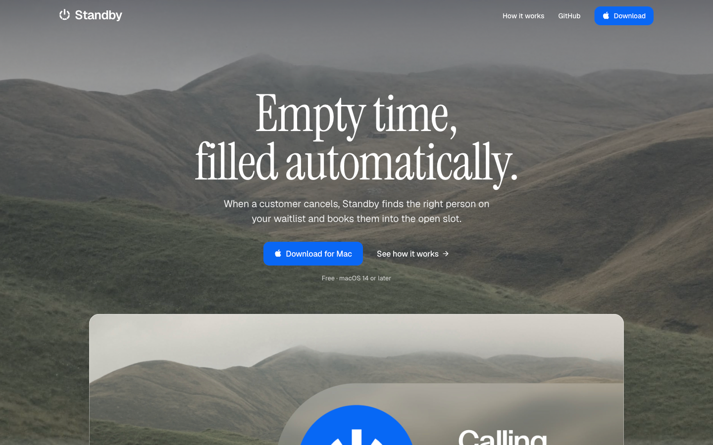

<p align="center">
  
</p>

<h1 align="center">Standby</h1>

<p align="center">
  <strong>Empty time, filled automatically.</strong><br />
  A Mac menu-bar app that refills cancelled appointments from your Google Calendar.
</p>

Standby watches the Google Calendars you choose. When an appointment is cancelled, the slot shows up in the menu
bar as an opening. Standby picks the best person on your waitlist (the service they want first, then who has waited
longest), offers them the slot, and when they say yes, one click books them into it on your Google Calendar.

Calls are simulated in this version, and the app says so. Bookings are real.

## What's here

```text
mac/                 Standby for Mac: a Swift package, SwiftUI on AppKit (see mac/README.md)
src/web/             the landing page
public/downloads/    Standby.dmg, built by mac/scripts/build.sh
public/landing/v2/   the mark, app icon, film, photos and the app's own renders
```

## The Mac app

macOS 14 or later, Apple silicon and Intel. It builds with the Command Line Tools alone:

```bash
cd mac
scripts/build.sh                 # Standby.app and public/downloads/Standby.dmg
scripts/build.sh --screenshots   # also re-renders the app screenshots the landing page uses
```

Without a Google OAuth client the app runs on a built-in sample calendar, so a downloaded copy always works.
[mac/README.md](mac/README.md) covers connecting Google, how cancellations are detected, testing, and opening the
ad-hoc-signed app the first time.

## The landing page

```bash
npm install
npm run dev     # http://127.0.0.1:5174
npm run check   # typecheck, tests and the production build
```

The site is static: Vercel serves `dist/`, and the old web demo's `/app` redirects to `/`.

## Stack

| Part | Technology |
| --- | --- |
| Mac app | Swift 6, SwiftUI and AppKit; Google OAuth (PKCE, loopback) and Calendar API v3 over URLSession |
| Landing page | React, TypeScript, Vite, Tailwind CSS; Instrument Serif and Geist |
| Tests | swift-testing; Vitest and Testing Library |
| Hosting | Vercel |
